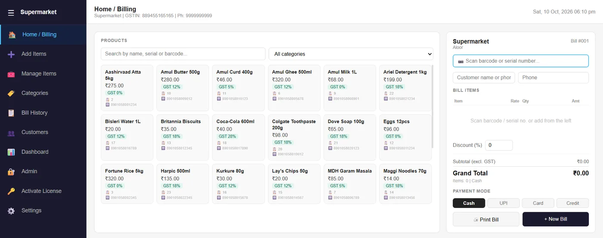
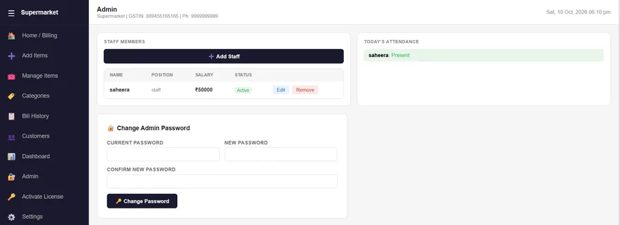
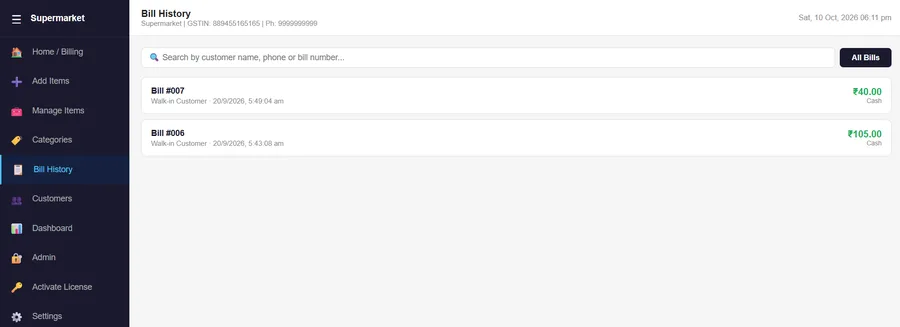

# Supermarket Management System


A desktop billing and store-management app for a supermarket. It handles a GST-aware product catalogue, **barcode billing**, bill history, customers, and an admin area for staff, attendance and salary.

<p align="center">
  
</p>
<p align="center">
  
  
</p>

## Features

- **Billing:** search or scan products by barcode, apply a discount, choose the payment mode (cash, UPI, card or credit) and print the bill.
- **Product catalogue:** add, edit and organise items by category, with GST.
- **Bill history:** search past bills by customer name, phone or bill number.
- **Customers:** manage customer records.
- **Dashboard** for the store.
- **Admin area:** manage staff, attendance and salary, and change the admin password.
- **License activation** and **settings** screens.

## Tech stack

- Electron desktop application (Windows)

<!-- Add the rest of your stack here, for example the database and any libraries. -->

## Getting started

### Prerequisites

- [Node.js](https://nodejs.org/) 18 or newer

### Run it

```bash
git clone https://github.com/Shahith645/Billing-Software.git
cd Billing-Software
npm install
npm start
```

### Build a Windows installer

```bash
npm run dist
```

> Commands above assume the standard Electron scripts in `package.json`. Adjust them if your script names differ.

## Author

**Shahith S**, final-year CSE student at University College of Engineering, Nagercoil
[GitHub](https://github.com/Shahith645) · [LinkedIn](https://www.linkedin.com/in/shahith-s/)
